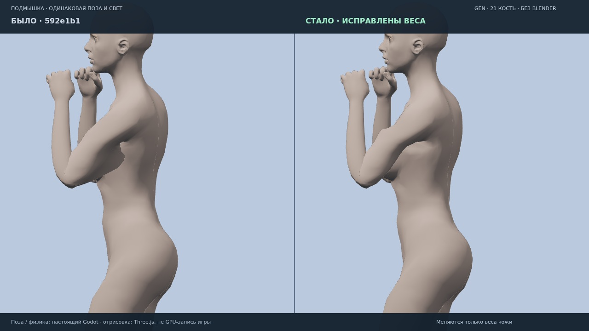

# 29 — Подмышки и обычное передвижение вне боя

База сравнения — `592e1b1`, после принятой правки бега и полного прыжка.
Новая обратная связь: тёмный участок под поднятой рукой делает её толстой;
для исследования уровня нужны обычные ходьба и бег, а не постоянная защита.

**Сделано в существующем проекте, без Blender и без замены исходной модели.**
[Видео проверки](animation-review/ordinary-locomotion-axilla.mp4) ·
[Запуск Godot](../prototype/README.md) · [Устройство анимаций](../prototype/ANIMATIONS.md).

## Что было под рукой




Это не просто слишком тёмная тень. Дефект воспроизведён в отдельном рендере:
он остаётся с другим материалом, с геометрическими вместо скинненных нормалей
и при включённом отсечении обратных граней. Менять яркость, закрывать участок
новым цветом или просто включать culling было бы маскировкой.

Причина — **чужие веса на двух близких, но разных поверхностях**. В позе
покоя рука опущена рядом с грудной клеткой. Автоматические веса по расстоянию
частично привязали внутреннюю сторону верхней руки к груди, а соседний бок
груди — к руке. При подъёме эти точки расходились; кожа превращалась в
широкую треугольную «перепонку». Toon-контур делал её ещё заметнее, но не
создавал саму геометрию дефекта.

### Адресная правка

Добавлен [`repair_shoulders.py`](../prototype/assets/heroine/repair_shoulders.py)
в воспроизводимую цепочку `sanitize_glb.py`:

1. Совпадающие вершины швов временно объединяются **для расчёта**, без изменения
   топологии GLB.
2. В узкой области под плечом граф настоящей поверхности разделяется на торс
   и две руки. Руки определяются по связности и существующим влияниям цепочек,
   **не отрезанием всех вершин левее/правее координаты X**.
3. Рука освобождается от груди; сохраняются пропорции влияния плеча,
   предплечья и кисти. На торсе убирается обратное подтягивание рукой.
4. Над подмышкой решается плавный гармонический переход по рёбрам сетки;
   центральная часть торса и верх плеча закреплены. К локтю правка плавно
   сходит на прежние веса.
5. Одинаковый результат получают все копии вершины шва.

Изменены веса **1 642 из 18 176** вершин тела. Позиции, нормали, UV, индексы,
материалы, запечённые кулаки, глаза, inverse bind matrices и 21 кость сохранены.
**Ни одного полигона не вырезано.** Прежние исправления кисть/бедро и сшивки
не отменены; свет и шейдеры игры не менялись.

При проверке формата обнаружились также старые границы `POSITION`,
оставшиеся от раскрытой кисти: запечённый кулак выступал за них примерно
на **0.025 мм**. Пересчитаны только `accessor.min/max`, без нового сдвига
геометрии; нулевые слоты новых весов получили нулевой индекс кости.

Оригинал `models/heroine/female_A_rigged.glb` не изменён:
`e5f8d6cd051e42db2967f534f749cd5bf684a218e7e006ed8218ecb534ea06ed`.
Новый рабочий safe GLB:
`79af26fbfd2765e35f2210c272b5c91f7090d1cdadc95e2da029001bbeca24b6`.

Это исправление весов, **не новый полноценный анатомический риг**. Сильный
сгиб всё ещё может терять объём при обычном линейном скиннинге; гарантии
отсутствия всех самопересечений и проблем будущей одежды нет.

## Обычный и боевой режимы

Теперь при запуске игрок стоит спокойно, с опущенными руками. Добавлены
три самостоятельных клипа в ту же библиотеку, которую читают игра и витрины:

| Клип | Цикл | Что отличается |
| --- | ---: | --- |
| `idle_relaxed` | 3.20 с | почти прямые ноги, ровный корпус, небольшое дыхание, руки внизу |
| `walk_relaxed` | 0.76 с, 1.24 м | контакт ближе к тазу, перекат пятка → стопа → носок, встречный свободный мах |
| `run_relaxed` | 0.54 с, 2.40 м | принятые ноги и толчок сохранены, корпус и руки менее напряжены |

У обычной ходьбы свой опорный рисунок, а не только опущенные кулаки. Более
ранний подъём пятки позволяет выпрямлять опорную ногу, не удерживая таз
низко. При развёрнутой наружу стопе учтена и боковая составляющая переката,
чтобы носок не уезжал в сторону. Прежний боевой `walk` не менялся.

Верх руки и локоть движутся согласованно, противоположно ноге. В спокойной
стойке и ходьбе предплечье развёрнуто так, чтобы кисть шла рядом с бедром,
а не резала его. Для этого не пришлось разводить обе руки в широкую A-позу.
Костей пальцев по-прежнему нет: используются существующие запечённые кулаки.

У `run_relaxed` **кривые таза и всех костей ног в точности совпадают с `run`**.
Так сохраняется понравившаяся работа ног; новый вариант меняет верх тела,
сгиб локтей и ориентацию кистей. Все прежние **11 клипов, включая прыжки,
обе атаки и боевую ходьбу/бег, сохранены без изменения ключей**.

### Управление и переходы

- **R** — обычная / боевая стойка игрока. Это физическая клавиша, независимо
  от раскладки; действие есть и в **Esc → Режим игрока**.
- ЛКМ/ПКМ запускают прежний удар **без дополнительной задержки** и автоматически
  включают боевую стойку. Полученный удар также включает бой; уклонённый — нет.
- Для выхода из боя нажать **R**. Скрытого таймера автоматического выхода нет.
- **T** осталась переключателем **боя клона**, а не стойки игрока. Выключенный
  клон стоит спокойно; включённый использует боевое передвижение.
- Смена режима занимает **0.25 с**, сохраняет фазу контакта стоп и не
  перезапускает шаг. R не отменяет удар/уворот и не меняет их таймеры.
- Скорости **1.65 / 4.6 м/с**, ускорение, стамина, урон, коллайдер и параметры
  прыжка не менялись. Фаза анимации, как раньше, зависит от реальных метров.
- В прыжке из обычного режима вход берётся из последней реальной позы,
  без вставленного кадра боевой защиты. После амортизации возвращается обычная
  стойка/походка. Сами принятые воздушные клипы и физическая траектория прежние.
- В HUD виден выбранный режим. В **H** и браузерной витрине доступны **14 клипов**;
  длинный список Godot прокручивается и не заходит под ползунок времени.

## Какие человеческие референсы изучены

Использовались не только словесные советы: открыты покадровая серия ходьбы
и FK-последовательности человеческого motion capture.

1. **Jacquelin Perry, Normal Gait, Atlas of Limb Prosthetics**, разделы stance,
   midstance / terminal stance / preswing:
   <https://www.oandplibrary.org/alp/chap13-01.asp>.
   Отсюда — разделение примерно 60% опоры / 40% переноса, двойная опора,
   последовательные rocker-фазы стопы и выпрямление ноги при переносе веса.
   Это ориентиры построения, а не утверждение о клинически точном воспроизведении.
2. **Eadweard Muybridge, A woman walking, 1887, plate 16**, Wellcome Collection:
   <https://wellcomecollection.org/works/qgbjy933>.
   Смотрел боковую последовательность и вид спереди/сзади: обычное положение
   корпуса, низкие руки, противофаза руки и ноги. В записи указан Public Domain Mark.
3. **CMU subject 16, `16_31` — walk**, и ранее изученный `16_35` — run/jog:
   <http://mocap.cs.cmu.edu/search.php?subjectnumber=16>.
   Для просмотра рассчитан FK исходных BVH с правильным порядком Euler-каналов,
   исключён добавленный конвертером нулевой T-кадр. Дополнительно просмотрен
   `16_15`; его начальный переход не использован как готовый цикл ходьбы.
   Конверсия взята из [una-dinosauria/cmu-mocap](https://github.com/una-dinosauria/cmu-mocap/tree/09a07f54f3bbb58797325f009282d0b2048a2871),
   зафиксированный commit `09a07f54f3bbb58797325f009282d0b2048a2871`.
4. **Kang et al., The elbow is the load-bearing joint during arm swing**,
   *Clin Shoulder Elbow*, 2023;26(2):126–130, DOI `10.5397/cise.2023.00101`:
   <https://www.cisejournal.org/upload/pdf/cise-2023-00101.pdf>.
   У 15 участников при ходьбе 1.11 м/с измерена амплитуда flexion–extension
   доминирующего локтя **29.7 ± 10.2° ROM**. Это **размах изменения**, а не
   предписание держать локоть под постоянными 30°. Статья также отмечает
   ограничения переноса ходьбы с заданной скоростью на естественную.

Клипы авторские, запечены аналитическим IK на наш скелет. **BVH не
ретаргетировались и не включены в репозиторий.** Темп и амплитуды адаптированы
под игровую скорость, короткие ноги модели и существующие кулаки, а не выданы
за точную копию движений конкретного человека.

CMU acknowledgment: “The data used in this project was obtained from
mocap.cs.cmu.edu.” Создание базы финансировалось NSF EIA-0196217.
Условия CMU допускают использование в составе работ, но не прямую перепродажу
данных, в том числе конвертированных. Внешние материалы остались локальными
референсами; в Git добавлены код, пояснения и собственный диагностический ролик.

## Проверки

- **21 Python-тест**: воспроизводимость и SHA модели/библиотеки; неизменность
  остального бинарного буфера; конечности/IK; замкнутые циклы; плоская опора и
  носочный перекат; швы; раздельные поверхности руки и груди; локальная
  деформация кожи; свободные кисти у бедра.
- **150 проверок настоящего Godot 4.7.2 headless**, 0 ошибок тестов: 14 нативных
  клипов; совпадение JSON/TRES; 30/60/120 FPS семплирования; смена стоек без
  сброса шага; обычный прыжок/возврат; R/T; реальная цепочка меню → main → игрок;
  автоматический вход в бой и сброс после смерти; прежняя физика/урон/витрина.
- **Khronos glTF Validator**: **0 ошибок**. Четыре прежние ошибки устаревших
  границ исправлены. Файл не назван «без предупреждений»: осталось **59 843**
  предупреждения (прежде 59 915), почти все — старые ненулевые индексы в
  нулевых слотах весов, повторённые для четырёх мешей; ещё 4 — иерархия
  skinned mesh. Они не менялись по существу и не скрывались фильтром валидатора.
- **Чистая копия без `.godot/`**: GLB и библиотека импортированы заново,
  затем те же 150 проверок и 120 кадров основной сцены прошли без ошибок
  скриптов/ресурсов. Полный import-runner честно сообщил ошибку: наша специально
  собранная headless-версия Godot без fontconfig напечатала 10 сообщений
  `Godot was compiled without fontconfig` при запуске редактора. Это ограничение
  локального движка, не ошибка GLB; строгая проверка логов не отключалась.
  После импорта тесты запускались отдельно с `--skip-import`. GPU не проверен.
- **Браузер**: 14 клипов, **70 поз**, управление, узкий экран, SHA ассета и
  изоляция статического сервера — пройдено.
- Записаны **1 680 нативных физических поз в 11 проходах**. Траектории обычной
  и боевой ходьбы, бега, прыжка с места и на бегу попарно совпадают. Контрольные
  боевые бег и оба прыжка также совпадают по положению тела с `592e1b1`.

Примеры численных регрессий (не художественная оценка):

| Измерение | Результат |
| --- | ---: |
| Таз обычной ходьбы, полный цикл | 0.853–0.890 м, среднее 0.876 м |
| Опорное колено обычной ходьбы | среднее 22.5°, максимум 38.7° с учётом preswing |
| Растяжение 600 рёбер внутренней верхней руки, 14 клипов × 35 поз | 0.849–1.165× исходной длины |
| Шов совпадающих вершин | 0.00000 мм |
| Низ кожи стоп, те же пробы | −4.31 мм — существующая мягкая деформация подошвы |
| Минимальный дискретный зазор кисть/бедро в обычных клипах | 7.81 мм |
| JSON / нативные кватернионы: `1 − abs(dot)` | около `6e-8` |

Проверка кисть/бедро локальная, по дискретным точкам поверхности и нормалям;
она не доказывает отсутствия всех пересечений сетки. Численные тесты дополняют
визуальный просмотр, а не заменяют его.

Команды из корня репозитория:

```sh
# Пересобрать safe GLB при необходимости; numpy нужен только автору:
.venv/bin/python prototype/assets/heroine/sanitize_glb.py models/heroine/female_A_rigged.glb prototype/assets/heroine/female_A_rigged_safe.glb
.venv/bin/python prototype/tools/animation/build_motion_set.py --check
.venv/bin/python -m unittest discover -s prototype/tools/animation -p 'test_*.py' -v
python prototype/tests/run_headless.py --godot /path/to/godot

# Экспорт физических поз, не GPU-видеозапись:
godot --headless --path prototype --fixed-fps 60 --script res://tests/record_motion.gd
```

## Что именно в видео

`animation-review/ordinary-locomotion-axilla.mp4`: **1280×720, 30 FPS, 19.4 с,
без звука, 1×**. Первые 4 секунды — прежний и исправленный safe GLB с
**одинаковой боевой позой, камерой, материалом и светом**. Затем — боевая и
обычная ходьба/бег на исправленной модели, переход R на ходу и полные прыжки
в обычном режиме с двух ракурсов. Просмотрены также отдельные кадры и серии
отрыва, полёта, контакта, возврата и переключения стойки.

Кости, смешивание и перемещение выгружены из настоящего Godot. Изображение —
**Three.js с нейтральным материалом**, не GPU-захват игры, не эмуляция игрового
toon-шейдера и не измерение FPS на целевом ноутбуке. Эту границу сохраняю явно.
