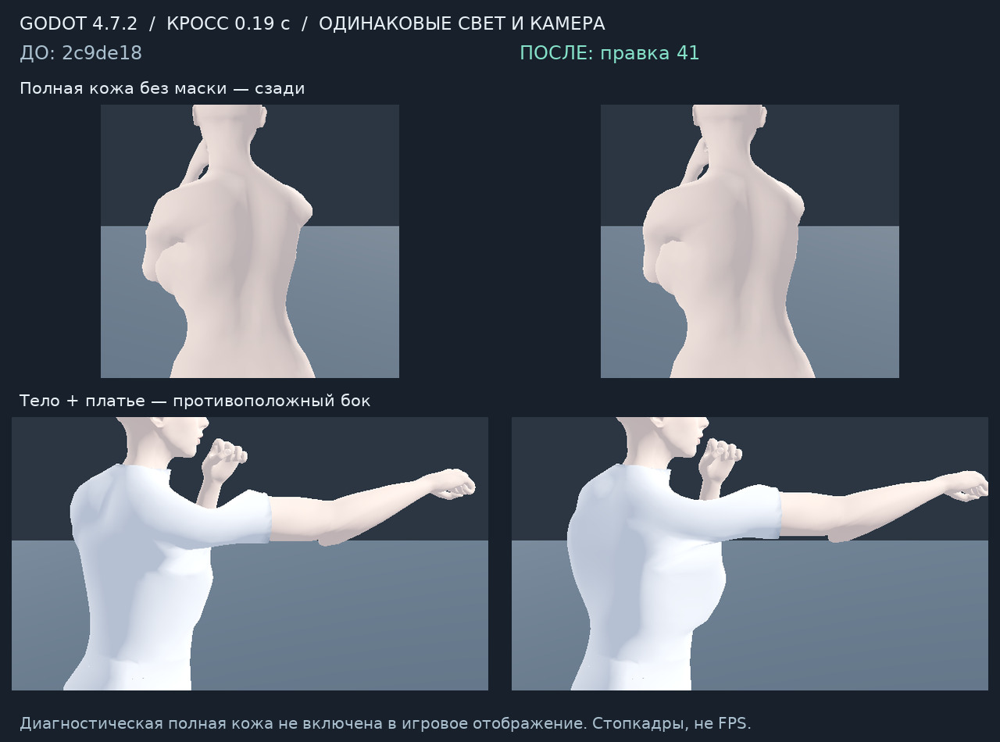
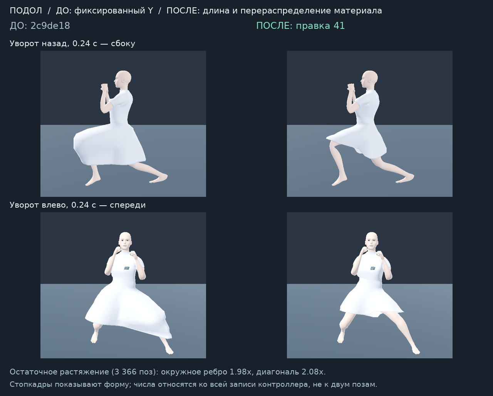
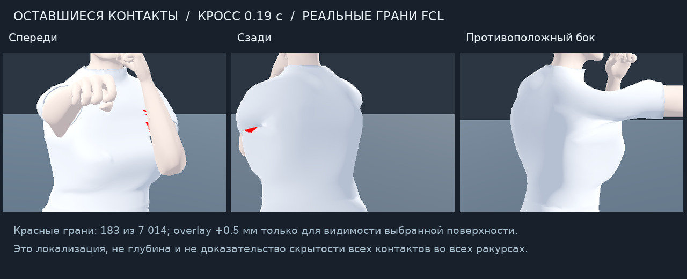

# 41. Плечи, подол и проверка в самом Godot

**Проверенный код:** [`422b1907b2423b63cfd29aaccf81445fba69ecbc`](https://github.com/IAmStarhead/Project-Gene/commit/422b1907b2423b63cfd29aaccf81445fba69ecbc).

**База сравнения:** `2c9de181beb64c0b9b314dcfde0bf059e6fc744e`. Отчёт и медиа добавлены отдельным коммитом, без последующих изменений этого кода. Задачи взяты из [аудита 40](https://github.com/IAmStarhead/Project-Gene/blob/d37ab3df90f30d9c63e5f6110901db122fef2057/reports/40-анимации-поручение-второму-агенту.md); сопутствующая графика той объединённой ветки сюда не переносилась.

## Результат коротко

- Уточнены плечевые веса safe GLB, поддержка ключиц в боевых позах, форма рукава/лифа и крепление метки. Резкость перехода уменьшена, но это **не заявление об анатомически идеальном плече**.
- Вместо раздувания юбки на фиксированной высоте материал может подниматься над коленом. Коробчатый выступ уворота назад и длинные боковые «стрелки» уменьшены; растяжение всё ещё заметное.
- Исправлено наложение guard-relative реакции рук при первом получении урона из обычной стойки. Оно давало четыре пересечения предплечий с юбкой в полной записи контроллера.
- Сохранены принятые обычные циклы, ноги/таз, остальные не-ручные кости, скорости и физика. Витрина больше не закрывает голову и стопы интерфейсом на проверенных размерах.
- **Юбка прошла независимый FCL-тест во всех четырёх записанных наборах. Лиф/рукава — нет:** контакты с телом остаются. Этот пункт аудита не объявляется закрытым.

### Что посмотреть

[Видео Godot, 33.97 с](animation-review/godot41-motion-review.mp4) ·
[Плечи: кожа и костюм до/после](animation-review/godot41-shoulders.jpg) ·
[Подол до/после](animation-review/godot41-skirt.jpg) ·
[Все 18 клипов, статический обзор](animation-review/godot41-clips-overview.jpg) ·
[Оставшиеся контакты](animation-review/godot41-contact-locations.jpg) ·
[Настоящая витрина 800×450](animation-review/godot41-showcase-800.png) ·
[Числа, SHA и границы проверки](animation-review/godot41-evidence.json)

Это изображения **самого Godot**, не Three.js. Старый `garment-sleeves-hem.mp4` из отчёта 37 — историческая диагностическая отрисовка Three.js; он не подменяет эту запись.

## 1. Откуда взялись проблемы плеча

Проверялись отдельно кости, полная кожа и костюм. Простое выключение платья не годится: игровой меш намеренно не содержит покрытые треугольники торса. В изолированной, не включённой в игру копии восстановлен исходный индексный буфер кожи, с теми же нативными Skin binds и морфом кистей.

У safe GLB сохранены **18 176 вершин, 33 300 треугольников, 21 кость**, rest-геометрия, UV и индексы. Изменены только веса плечевого перехода:

- Вместо гармонической интерполяции с резким изменением производной на границе минимизируется квадрат графового лапласиана, включая фиксированное соседнее кольцо. Граф не перепрыгивает с руки на грудь через воздух.
- 708 свободных сваренных точек. Относительно `2c9de18` веса существенно изменены у **710 вершин** (порог `1e-6` по плотным весам). Число **1 766** в отчёте генератора относится к источнику **до плечевого ремонта**, а не к этой базе сравнения. Исходный GLB в `models/` не заменён.
- Численно нулевые веса ниже `1e-10` обнуляются **до** выбора четырёх влияний. Иначе хвосты LAPACK могли менять padding-joints и ломать побайтовую повторяемость. Тест требует точного совпадения повторной сборки; межплатформенная/межпоточная повторяемость отдельно не доказана.

В guard и действиях ключицы немного участвуют в достижении вперёд. Старые цели кистей после этого давали лишний сгиб локтя. Визуальная конечная цель вынесена вперёд на **32.395 мм для джеба / 28.352 мм для кросса**; сгиб локтя у контакта около **11.48°**. Контакт остался на `.18 с`, активная фаза заканчивается на `.30 с`. Радиус, конус, урон и игровые таймеры от новой позиции кисти не вычисляются и не менялись.

В костюме:

- Прибавка короткого рукава сужается с **10 до 8 мм**, а не образует большой округлый валик.
- Перед лифа сглажен суперэллиптической оболочкой вместо копирования двух анатомических выступов.
- После сглаживания для выбранной зоны плеча/руки проверяется отступ **6 мм по нормали исходной кожи**. Это rest-space ограничение, не гарантия зазора после любого LBS-смешивания.
- Метка получает барицентрические веса ткани под ней вместо жёсткого `chest=1`; её локальный вынос — 4 мм.



Уменьшение заломов не означает исчезновения всех неровностей силуэта. Внешний вид плеча ещё требует художественной оценки в целевом игровом рендере.

### Маска не расширена

Параметры покрытия зафиксированы тестом, SHA `38b65962878c656020cedaeeaa125e272f7176ee7a129a553532db610d55d894`. Не добавлены широкие цилиндры скрытия рукавов. Сохраняются прежние проксимальные сердцевины подмышек и 53 мм перекрытия кожи до манжеты.

Число оставляемых треугольников тела изменилось **27 346 → 27 342**: классификация использует веса, а они изменились. Это не побитовое сохранение списка граней, но и не увеличение области маски. Полная диагностическая кожа, специальные камеры и магента-материал в игровой код не включены.

## 2. Подол: подъём материала вместо коробчатого раздувания

`arc_length_drape_v4` остаётся ограниченным визуальным решателем, **не полноценным cloth**:

1. Рендер — прежние **32×10 = 320 вершин** на актёра. Поддерживающая диаграмма — **19×32 = 608 лучей**, включая промежутки между рядами/узлами.
2. Поддержка берётся от таза и разделённых участков бедра/голени; дополнительно учитываются верхние касательные капсул между рядами.
3. Меридианы пересэмплируются по длине материала. Поднятое колено может поднять нижние ряды, а не раздвигать всю юбку при прежнем Y.
4. У окружности мягкая цель **1.45×**. При превышении уменьшается использованная вниз дуга, но этот шаг не сжимает её ниже **86%**. Это не жёсткий предел растяжения.
5. После сглаживания края выполняются три прохода ограничения меридианов/контакта; в первых двух — ещё и перераспределение точек по длине окружности. Остаточная ошибка проекции исправляется локально.
6. Вторичное движение ограничено **12 мм**, талия закреплена. Пауза сохраняет историю, seek/телепорт её сбрасывает. Реализация JavaScript повторяет нативный алгоритм, а не проигрывает записанные координаты ткани.



### Измерены не только суммарные длины

Отношение длины отображаемого ребра к соответствующему rest-ребру — **не механическое напряжение**. Только полная длина меридиана скрывала сильное локальное искажение: одна из отвергнутых промежуточных версий давала до **5.88×** на окружном ребре. Добавлены отдельные локальные проверки; допуски не ослаблялись ради последней версии. Два прохода не укладывались в локальный предел 2.50×; оставлены три.

Максимумы по **3 066 позам игрока + 300 позам клона**:

| Метрика отображаемого материала / rest | Максимум | Где |
| --- | ---: | --- |
| Полный меридиан | 1.016805× | `dodge_left`, кадр 22, игрок |
| Полная окружность | 1.774469× | `dodge_right`, кадр 31, игрок |
| Локальное меридиональное ребро | 1.061471× | `modifiers`, кадр 126, игрок |
| Локальное окружное ребро | 1.977472× | `dodge_back`, кадр 34, игрок |
| Диагональ ячейки | 2.076291× | `dodge_left`, кадр 29, игрок |

Отдельный нативный stress-набор уворотов/спринта при **30/60/120 Гц**: полные меридианы/окружности **1.0200× / 1.7676×**, локальные рёбра **1.1466× / 2.2358×**. Это другой набор, поэтому его максимумы не обязаны совпадать с таблицей.

Материал всё ещё может растягиваться почти вдвое и образовывать условные складки. Уменьшение выступов не выдаётся за физически нерастяжимую ткань.

## 3. Четыре контакта, которых не было в проверке отдельных клипов

Полная запись контроллера сначала **не прошла** `--require-skirt-clear`: юбка пересекалась с предплечьями в `clone_uniform/player:128–131` — 11/43/36/19 пар контактов. Пересечений ног в этих четырёх позах не обнаружено.

Причина — `hit` авторится относительно guard, но его дельта рук на полной силе накладывалась на ещё опущенные обычные руки в начале входа в бой. Теперь только guard-relative дельта `shoulder/upper_arm/forearm/hand` умножается на `_combat_blend`. Реакция груди/головы остаётся немедленной, ноги не заменяются.

Добавлены нативные проверки нулевого, половинного и полного веса этой дельты. После правки заново записаны реальные позы: окрестность 125–141 и затем **все 3 366 actor-поз** прошли независимый skirt-clear тест. Пробный синтетический пересчёт не использован как итоговое доказательство.

## 4. Что действительно сохранилось

Относительно `2c9de18`:

- Все ключи **четырёх обычных клипов целиком**, включая принятые руки/голову, совпадают точно.
- Во всех 18 клипах защищены таз, тайминги, метаданные и все вращения, кроме явно разрешённых плечевых/ручных костей.
- В свежей парной записи одинакового ввода: **20 проходов, 3 066 поз игрока и 300 поз клона**. Максимальная разница защищённых вращений — **0**, таза — **0 м**. Нет отличий перемещения, ориентации, фазы, gait/sprint/combat blend, действий и раскрытия кистей.
- Подол и разрешённые плечи/руки отличаются намеренно. Хеш защищённой части движений и хеш уворотов приведены в JSON-доказательствах.
- Скорости **1.15 / 2.90 / 5.60 м/с**, приоритет Shift над Alt, дальность/направление уворотов, стоимость, неуязвимость и таймеры атак не менялись. Нативные увороты при 30/60/120 Гц дают **1.099999–1.100002 м**; стены останавливают все три прогона.

Это не переавторивание одобренных ног ради одежды. Коррекция подошвы рассчитана на локальную плоскость: нет terrain IK или гарантии всех контактов при любых поворотах/поверхностях.

## 5. Контакты лифа и рукавов остаются

FCL сравнивает реальные треугольники одежды с телом **после действующего игрового покрытия**, с учётом формы мягких кистей и нативной позы. Он не использует зазор до капсулы как замену поверхности кожи.

| Свежий набор | Проверено выборок | Юбка: пересекающихся | Лиф/рукава: пересекающихся |
| --- | ---: | ---: | ---: |
| Все 18 клипов, прогретые циклы | 848 | **0** | **848** |
| Точные seek, включая позы аудита | 14 | **0** | **14** |
| Физический контроллер: игрок + клон | 3 366 | **0** | **3 366** |
| Запись Godot WebGL: оба актёра | 508 | **0** | **508** |

Это пересекающиеся по содержанию наборы, не 4 736 уникальных состояний. Во всех запусках проверены SHA модели, appearance, motion, runtime ткани и контроллера; устаревшие трассы отклоняются.

### Локализация вместо утверждения «всё скрыто»

`--contact-details` сохраняет точные ID треугольников и точки контакта для выбранного stamped-меша. На этих же гранях сделан overlay в Godot:

| Поза | Пар контактов лифа | Уникальных граней лифа |
| --- | ---: | ---: |
| `guard`, 0.00 с | 179 | 120 |
| `attack_left`, 0.18 с | 175 | 123 |
| `attack_right`, 0.19 с | 257 | 183 |
| `dodge_left`, 0.24 с | 200 | 133 |



В кроссе выбранные грани находятся в rest-диапазоне Y **1.18594–1.33480 м**; на overlay видны узкие красные участки в зоне пройм. Красный материал вынесен на **0.5 мм исключительно для отображения выбранных граней**. Это не глубина проникновения и не точная анатомическая классификация. Приблизительные имена частей тела в FCL получены по доминирующим весам, а не по семантической разметке.

В полной записи также остались контакты лифа с предплечьями: 72 выборки слева / 65 справа; в WebGL-наборе — по 6. Нельзя объявить их автоматически безопасными, полностью невидимыми или устранёнными по одному ракурсу. Нужна дальнейшая адресная работа с лифом/проймой и оценкой видимого пробоя. **Пункт 3 аудита 40 не закрыт.**

Нет общей самоколлизии, контакта ткани с руками/стенами/предметами или обратного влияния на физическое тело. Пройденный тест стены относится к `CharacterBody3D`, не к cloth/wall collision.

## 6. Что именно записано в видео

**Godot 4.7.2 `custom_build.3d95ead8f`, Compatibility/WebGL2, Chromium/SwiftShader; Emscripten 4.0.14, single-threaded WASM.** Это не официальный Windows-бинарник, OpenGL 3.3 на 940MX или GPU-бенчмарк.

- Скриншот принимается только после нативного `RenderingServer.frame_post_draw`. Кадр удерживается до следующей команды; JavaScript не рисует персонажа заново.
- **254 различных игровых framebuffer-кадра**: 82 передвижения/переходов, 48 четырёх уворотов, 70 прыжков/ударов, 54 взаимодействия с клоном. Перед ними есть один дополнительный исходный кадр сцены, не включённый в движущиеся фрагменты.
- Физика и ткань выполняют все тики **60 Гц**. Для записи берётся каждый пятый тик: **12 различных кадров/с**, с сохранением двухтиковых концов отдельных действий. В MP4 кадры повторены в контейнере 60 fps; время движущихся фрагментов — **1×**, а не искусственное замедление. Это **не непрерывные 60 различных кадров/с**.
- Окно/исходный игровой canvas **800×450**; диагностический root viewport сообщал 1280×720. В итоговом **1280×720** исходные игровые изображения увеличены до 1152×648 для читаемости. Это не добавляет детализации.
- Весь MP4 полностью декодирован: **2 038 кадров / 33.9667 с**, без звука, около 1.4 МБ. Контрольные SHA есть в JSON.

### Отличия условий записи от обычной игры

Они внесены **только в игнорируемую изолированную копию**, не в production-свет/физику:

- Отключены тени, MSAA и glow; существующие источники уменьшены до `1.05 / .18 / .06`, ambient `.35`, tonemapping filmic, exposure `.9`. Без этого светлый костюм в боковых видах программного рендера терял форму. Материалы, меши, коллайдеры, сцены и контроллеры сохранены.
- Передвижение стартует в `(7.8, .03, 4)` вдоль свободного переднего прохода комнаты. На прежнем диагностическом маршруте героиня упиралась в центральную лестницу, которая закрывала ноги. В финальной записи все движущиеся отрезки действительно перемещаются, остаются на плоском полу; переноса посреди прохода нет.
- Камеры диагностические, HUD/Label3D скрыты. Начальное положение пары и её ориентация заданы для съёмки; противник далее использует настоящий ИИ.
- Команды автоматизированы через обычные Input actions/буферы действий. Отдельный участок вызывает настоящий `take_damage(5)` для проверки реакции из обычной стойки. Это тестовый урон, не попадание противника.

В парном участке игрок действительно получает урон от ИИ (**100 → 58**), клон — от игрока (**120 → 96**). В записи есть 9 выборок с активным hit-overlay игрока и 4 клона; в отдельном тесте урона — ещё 3. Проверяется `_hit_time` и итоговая поза, а не поиск верхнеуровневого состояния `hit`: реакция аддитивная и может идти при состоянии `ground`/`attack_R`.

### Содержание MP4

| Время | Содержание |
| --- | --- |
| 0–4.00 с | Среда и оговорки записи |
| 4.00–9.00 с | Сопоставимые стопкадры плеча и подола до/после |
| 9.00–15.83 с | Alt / обычный бег / Shift, R на ходу в обе стороны, остановка |
| 15.83–19.83 с | Четыре уворота |
| 19.83–25.57 с | Два полных прыжка/посадки, тестовый урон, две серии левой/правой |
| 25.57–29.97 с | Игрок и клон, атаки, попадания и реакции |
| 29.97–31.97 с | Настоящая production-витрина 800×450 |
| 31.97–33.97 с | Локализация оставшихся контактов |

Дополнительно получены **29 синхронных пар** до/после: одинаковые команды, времена и камеры проверены по метаданным кадра и нативным кватернионам. Для пяти проблемных клипов есть по три магента-ракурса на версию. [Обзор всех 18 клипов](animation-review/godot41-clips-overview.jpg) показывает по одной 50%-ной позе с последовательным обновлением ткани и прогревом циклов — **не все фазы и не непрерывную анимацию**. Это не повтор 432-кадрового углового аудита 40 и не доказательство всех возможных переходов.

## 7. Витрина и ошибка времени жизни материалов

Интерфейс витрины вынесен в UI-only `showcase_controls.gd`: заголовок/подпись — в боковой колонке, камера вписывает голову и стопы в свободный прямоугольник. Добавлены «Весь рост» и **V** для скрытия UI. Клавиатурные подсказки используют `Left/Right`, `Up/Down`, `3/4` вместо отсутствовавших стрелочных глифов. Физическая клавиша обрабатывается с fallback на `keycode`.

**Отдельно, без диагностических хуков**, проверен production-pack с настоящей клавиатурой браузера: **8 снимков, реальные canvas 800×450 / 1024×576 / 1280×720, два H-перехода туда/обратно, V, кадр/клип, G**. Canvas действительно меняет физический размер, а не только CSS. Ошибок Godot/JavaScript — **0**; остаётся известное предупреждение screen-space AA в Compatibility.

Повторные переходы main ↔ showcase ранее выявили нативные `material_* null` ошибки GLES3. Неизменяемые toon-материалы теперь кэшируются по исходному surface-материалу и переживают отложенную передачу сцен. Textile-меши и их независимые оттенки не затрагиваются; параметры освещения комнаты не менялись.

## 8. Проверки и среда

| Проверка | Итог |
| --- | --- |
| Строгий нативный suite Godot | **606 проверок, 0 ошибок** |
| Python | **40 тестов, OK** |
| Оба генератора `--check` | Совпали с файлами в коммите |
| JavaScript `npm run check` | Пройден |
| Браузерный suite | **18 клипов / 90 поз**, pause/seek/resume ткани, управление, mobile layout, изоляция сервера |
| Независимый живой JS/native решатель | **848 кадров + 14 seek**, максимум **0.0974 мм** при допуске 0.25 мм |
| Нативный sampler / исходные ключи | `1−abs(dot)` до `6e-8`, таз до `2e-9 м` |
| Настоящие мягко скиненные подошвы | **2 410 вершин / 48 blend-поз**, минимум +1 мм, ошибка опорного набора 0.003 мм |
| Импортированные мягкие кисти | Сопоставлены 3 404 вершины |
| Независимый FCL | Таблица выше; **не all-clear для лифа** |

Headless-профиль ткани по 848 выборкам: median **15 019 мкс**, p95 **20 808 мкс**, max **29 784 мкс** на этом sandbox CPU. Это не FPS, не GPU-время и не доказательство бюджета двух персонажей на 940MX.

Нативный suite запускался местной custom-сборкой **по уже импортированному проекту с `--skip-import`**. Её fresh editor import печатает ошибки fontconfig, даже возвращая exit 0; строгий runner их не игнорирует и не был ослаблен. Чистый импорт официального Godot 4.7.2 на целевой Windows-машине ещё нужно проверить. Версии Python/NumPy/SciPy/FCL и все пять входных SHA перечислены в `godot41-evidence.json`.

## 9. Как перепроверить

В целевой среде сначала открыть `prototype/project.godot` официальным Godot 4.7.2, дождаться импорта, **F5 → H**. Осмотреть весь цикл на 1×, затем проблемные времена; в игре — модификаторы, R, четыре уворота, F, серии ЛКМ/ПКМ и T. Отдельно проверить ступни, проймы и контакт с окружением. Полная кожа из диагностики для F5 не нужна.

Команды ниже — для POSIX shell; пути к Python/Godot локальные:

```sh
python3 -m unittest discover -s prototype/tools/animation -p 'test_*.py' -v
python3 prototype/tools/animation/build_appearance.py --check
python3 prototype/tools/animation/build_motion_set.py --check
python3 prototype/tests/run_headless.py --godot /path/to/Godot_4.7.2

mkdir -p .local/review/41
GEN_GARMENT_OUTPUT="$PWD/.local/review/41/garment.json" /path/to/Godot_4.7.2 \
  --headless --path prototype --fixed-fps 60 --script res://tests/record_garment.gd
python3 prototype/tools/animation/check_garment_contacts.py \
  .local/review/41/garment.json --require-skirt-clear --output .local/review/41/contacts.json
python3 prototype/tools/animation/check_garment_contacts.py \
  .local/review/41/garment.json --seeks-only --contact-details --require-skirt-clear \
  --output .local/review/41/seek-contacts.json

GEN_TRACE_OUTPUT="$PWD/.local/review/41/controller.json" /path/to/Godot_4.7.2 \
  --headless --path prototype --fixed-fps 60 --script res://tests/record_motion.gd
```

Python-зависимости генераторов — `prototype/tools/animation/requirements.txt`, опционального FCL — `requirements-review.txt`. Для проверки всех записанных актёров нужно развернуть вложенного клона, **не пересчитывая позы и не подменяя SHA**:

```sh
python3 - <<'PY'
import json
from pathlib import Path
p = Path('.local/review/41')
t = json.loads((p/'controller.json').read_text())
takes = t.pop('takes')
t['takes'] = {name+'/player': frames for name, frames in takes.items()}
t['takes'].update({name+'/clone': [f['clone'] for f in frames]
                   for name, frames in takes.items() if frames and 'clone' in frames[0]})
t['seeks'] = {}
(p/'controller-actors.json').write_text(json.dumps(t, separators=(',', ':')))
PY
python3 prototype/tools/animation/check_garment_contacts.py \
  .local/review/41/controller-actors.json --require-skirt-clear \
  --output .local/review/41/controller-contacts.json
```

Живую JS/native-проверку запускать по **новой** garment-трассе согласно [README просмотрщика](../prototype/animation_preview/README.md). Сырые трассы, детальные контактные пары, PNG-последовательности, full-skin проект и инструменты съёмки остались вне Git; в репозитории — компактные итоговые медиа и проверенные агрегаты с SHA.

## Что ещё не принято и не доказано

- Все пересечения лифа/рукавов **не устранены** и не классифицированы по signed depth/видимости.
- Подол остаётся растяжимой радиальной моделью без общей самоколлизии и cloth/hand/wall/object collision.
- Нет универсальной гарантии подошвы на рельефе и всех фаз/ракурсов/смешиваний.
- Нет проверки официальной Windows/OpenGL 3.3 сборки или FPS на GeForce 940MX, особенно с двумя актёрами.
- Эти тесты и выборочное видео не заменяют пользовательскую художественную приёмку плеч, шага, ткани и уворотов.
