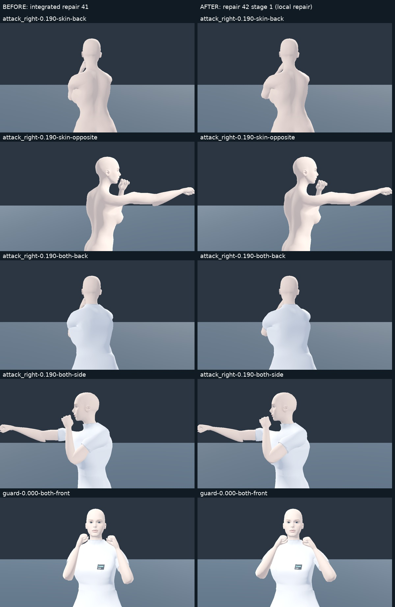
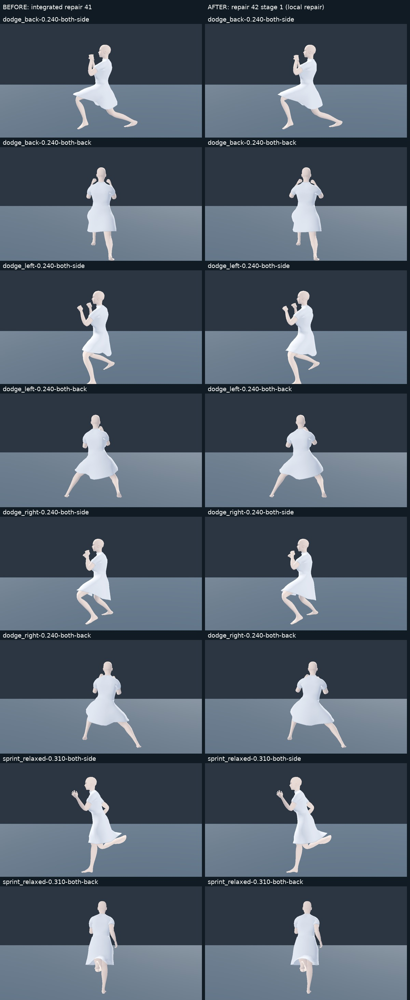
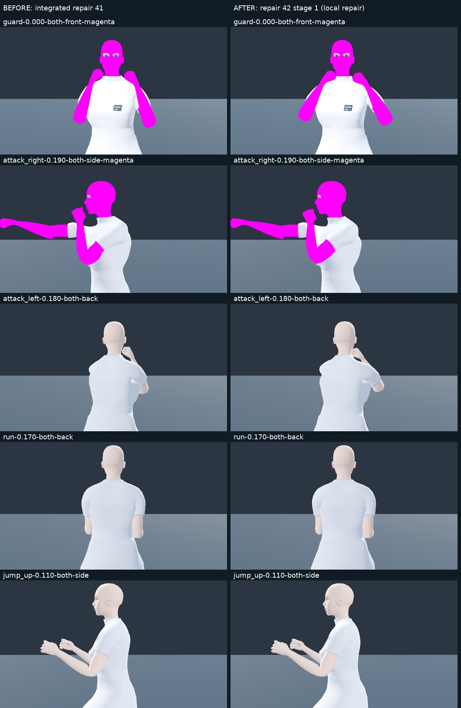
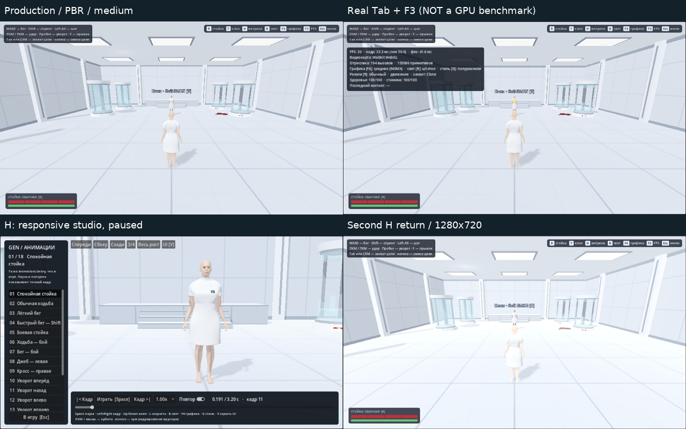

# 43. Результат поручения 42: интеграция и локальный ремонт, не вся новая система

**Сделан и проверен пакет интеграции и адресных исправлений первого этапа.**
Ремонт 41 теперь работает вместе с более поздней лабораторией, светом,
HUD, камерой, lock-on и проверкой контакта удара. Уточнены плечевые веса,
плоскость боевого локтя, верх лифа, внутренняя обтачка и поддержка подола.

**Не объявляю закрытыми все визуальные требования обязательного этапа:**
угловатость плеча/спины и отдельные заострения ткани ещё видны; лиф/рукава
по-прежнему имеют треугольные контакты. Новые стрейфы, топ со штанами,
дополнительные удары и зонально выбранные реакции **не реализованы**.
Это не отчёт «всё поручение 42 выполнено».

## 1. Точные исходники и интеграция

- Ветка: **`arena/320aeafc-project-gene`**. Автоматического merge в `main`
  или в другую рабочую ветку не делалось.
- Старт этой работы над поручением 42: **`1d5d20b2b4bf6ddf5250f7ef322f19db7d2f9d78`**;
  код предыдущего ремонта — `422b1907b2423b63cfd29aaccf81445fba69ecbc`,
  его старая база — `2c9de181beb64c0b9b314dcfde0bf059e6fc744e`.
- Задание зафиксировано из **`2fa4094b0b0cd14fe9717cf71f0dc463fcace47e`**:
  [неизменённый текст поручения 42](42-поручение-стрейф-форма-и-удары.md).
  Объединённая production-база в нём — **`d37ab3df90f30d9c63e5f6110901db122fef2057`**.
- Конечный **проверенный commit кода**:
  **[`469953c86ada848094c976e601bf44a86e6107e3`](https://github.com/IAmStarhead/Project-Gene/commit/469953c86ada848094c976e601bf44a86e6107e3)**.
  Отчёт, исторические документы, медиа и проверка их целостности — следующий
  отдельный commit; его точный hash доступен в истории этого файла и в итоговом сообщении.

Это целевой перенос файлов/функций в рабочее дерево, **не blanket ours/theirs**.
Пятнадцать production-файлов оставлены побайтно как в зафиксированном incoming:
`project.godot`, три actor-сцены, `camera_rig.gd`, `player.gd`,
`clone_enemy.gd`, `dummy_target.gd`, `main.gd`, `pause_menu.gd`, `tuning.gd`,
новые `hit_check.gd`, `hud.gd`, `lock_on.gd`, `shaders/toon_light.gd`.
Проверка этого равенства включена в сборку доказательств.

Конфликтующие функции объединены отдельно:

- **`build_scene.gd`:** сохранены новая белая лаборатория, спавны, два
  заполняющих источника, пресеты качества/яркости, PBR/toon. Из 41 сохранено
  время жизни неизменяемого toon-материала; такой же кэш добавлен для нового
  PBR override. Смена сцен не уничтожает используемый override и не создаёт
  новый материал при каждом обходе сцены. Нативные проверки и реальные
  WebGL-переходы H/G это проверяют; это не сертификат всех драйверов OpenGL.
- **`showcase.gd`:** сохранены адаптивные панели, вписывание головы/стоп и V
  из 41, добавлены incoming-ограничения камеры стеной/полом. Луч строится от
  действительного смещённого UI-фокуса, а не от старого фиксированного центра.
  B/F4/G сохраняют студийный, а не случайно игровой свет.
- `showcase_controls.gd`: прежняя адаптивная раскладка плюс подсказка F4.
- README и индекс отчётов сведены вручную. Восстановлены отсутствовавшие
  исторические отчёты 33–36, 38–40, поручение 42 и их изображения **без правок**
  из pinned incoming. Старые слова «точные хитбоксы» в историческом отчёте 35
  не означают точную анатомию текущего прототипа.

Полный список **37 изменённых source-файлов** — в
[машиночитаемых результатах](animation-review/godot42-evidence.json),
`changed_source_files`. Он не включает большие сырые трейсы/кэши.

## 2. Плечо: кожа, поза и одежда проверялись раздельно

[Крупные сравнения до/после](animation-review/godot42-shoulder.jpg):



В игровой модели скрыты покрытые платьем треугольники. Поэтому для диагностики
в отдельной копии восстановлены **исходные индексы тела**, с сохранением
нативных skin/blend-массивов. Просто выключенное платье полной кожей не считалось.
Эта версия **не включена в игру**.

Точный `cross .19` снят спереди, сзади и с обеих сторон, отдельно кожа/одежда.
Дополнительно сняты `.16 / .18 / .20`, guard, джеб, боевой бег, прыжок,
увороты и спринт. Всего **33 до + 33 после**, с проверкой пяти SHA, ID команды
и завершения **нативного `frame_post_draw`**. Матрица поз/ракурсов находится
в [архиве команд](animation-review/godot42-capture/README.md).
Это отдельный диагностический свет, одинаковый для обеих версий, не свет игры.

### Что изменено

1. **Весовой переход шеи/ключицы/плеча.** Старая фиксированная граница
   решения y=1.433 м проходила через деформируемый воротниковый переход.
   Свободная область продлена до y=1.49 м, внутренняя граница шеи сдвинута
   с |x|=.055 до .035 м. Тот же solve по связности поверхности, не перенос
   веса через воздушный зазор к соседней руке. Добавлен геометрический тест
   collar-графа; это локальный диагностический показатель, не оценка анатомической красоты.
2. **Плоскость защитного локтя.** `GUARD_ELBOW_SPREAD=.38` вместо прежнего .30.
   Локоть отходит примерно на 35–40 мм, чтобы не быть прижатым к верхнему лифу.
   Это изменение позы заявлено явно, а не выдано за одни веса.
3. **Верх лифа.** Латеральная квадратность суперэллипса плавно уменьшается
   на y=1.23–1.33 м; низ переда сохраняет более плоский тканевый вид. Старый
   верхний широкий профиль выносил панель в область защитной руки.
4. **Внутренняя обтачка манжеты** укорочена 22→14 мм: её прямой внутренний
   участок заходил к более толстой проксимальной части руки. Внешний край
   манжеты оставлен **точно на прежнем месте**, рукав не раздут.

Промежуточный вариант с полностью эллиптической шириной дал новую неровность
переда и **не принят**. Безусловный отступ от всей кожи тоже не принят;
оставлена прежняя адресная проверка отступа верхнего торса/руки.

### Что точно сохранено

- Позиции, rest-нормали и индексы тела, UV, узлы/скелет/bind pose, исходный GLB,
  мягкая форма кистей и floor probes. В safe GLB относительно 41 изменены
  **914 строк весов**, только y≈1.2406–1.4864 м.
- Маска покрытия **побайтно по параметрам прежняя**; её frozen SHA в тесте —
  `38b65962878c656020cedaeeaa125e272f7176ee7a129a553532db610d55d894`.
  Из-за весовой классификации вместо 27 342 сохранены **27 356** треугольников
  игрового тела: **0 новых скрытых, 14 дополнительно сохранённых**.
- Все ключи таза, все метаданные/тайминги и **все кости, кроме `upper_arm.L/R`**.
  Четыре обычных клипа целиком неизменны. Это новый точный frozen-хеш,
  а не только визуальное сравнение ног.
- Изменены только верхние руки в `guard`, `walk`, `attack_left/right`,
  четырёх уворотах, `jump_start`, `land`, `hit`. `run`, `jump_up/down` и
  четыре `*_relaxed` не переавторивались.

**Не утверждаю неизменность мировых кулаков.** На запечённых ключах центры
запястий совпадают с предыдущими в пределах 8.7 нм. Но на 241 промежуточной
пробе каждого клипа разница достигает **2.6654 мм**, а мировая ориентация
кулака меняется до **11.70°**. Авторские цели и таймеры сохранены;
ориентация/интерполяция — нет. Это не swept-проверка костяшек. В incoming-проверке
живого удара используется центр кости кисти; поэтому побитная неизменность всех
пограничных hit/miss не доказана, даже при сохранённых численных параметрах боя.

На текущей полной коже переход мягче лишь **локально**: гребень у основания
шеи/плеча и сжатая форма спины кросса ещё читаются. На манжете остаётся
ступенчатость. Эти кадры не являются художественной приёмкой плеча.

## 3. Подол: сопоставимые длины и движение

[Сравнение трёх уворотов .24 и спринта .31, бок/спина](animation-review/godot42-hem.jpg):



Сохранены платье, 320 render-узлов, 608 лучей поддержки, капсулы,
пересэмплирование по длине материала, три последующих меридиональных и два
угловых прохода. Изменено только предварительное одностороннее сглаживание
радиусов поддержки: **четыре прохода вместо двух**, симметрично в GDScript и JS.
Это не новая общая система коллизий.

На **том же нативном stress-наборе** (включая 30/60/120 Гц):

| Отображаемая длина / соответствующая rest-длина | До | После | Прежний предел |
| --- | ---: | ---: | ---: |
| Локальное меридиональное ребро | 1.1466× | **1.2294×** | 1.25× |
| Локальное окружное ребро | 2.2358× | **1.9653×** | 2.50× |
| Полный меридиан | 1.0200× | **1.0181×** | 1.04× |
| Полная окружность | 1.7676× | **1.7765×** | 1.90× |

Окружное ребро улучшилось примерно на 12.1%, **меридиональное стало хуже**,
хотя осталось в старом допуске. Пределы не менялись. Эти числа — **не напряжение
ткани**, не гарантия нерастяжимости и не замена силуэту.

В 3 366 actor-позах реального нативного контроллера максимумы после правки:
локальный меридиан **1.0460×**, окружность **1.9236×**, диагональ **2.0179×**;
полный меридиан/окружность **1.0171× / 1.7726×**. Силуэт некоторых выступов
шире и мягче, но у заднего/бокового ухода остаются острые участки и заметное
растяжение. Последовательности движения проверены также реальными
контроллерами, не только точным seek. Полноценным cloth это не стало.

### Цена на доступном CPU

Последовательный прогон **до, затем после**, один актёр, одинаковые 848
измеряемых шагов после прогрева, без параллельного рендера/FCL:

| Headless sandbox CPU | До | После |
| --- | ---: | ---: |
| Медиана `update_pose` | 19.357 мс | 19.761 мс |
| p95 | 21.728 мс | 22.939 мс |
| Максимум | 35.026 мс | 38.403 мс |

Это один сравнительный прогон, а не статистически устойчивый benchmark.
Стоимость остаётся значительной; **это не FPS игры, не замер двух актёров
и не прогноз для i3/940MX**. Новый костюм и его цену здесь сравнивать не с чем.
Оптимизация сна пассивного клона из incoming сохранена.

## 4. Треугольные контакты и ошибка readback спящего клона

Тестируются фактически отображаемые треугольники юбки и игровая кожа с её
реальной маской; источник/ресурсы и runtime защищены SHA. Текущие результаты:

| Набор | Actor-поз / кадров | Юбка: кадры с контактом | Лиф/рукава: кадры с контактом |
| --- | ---: | ---: | ---: |
| Нативные реальные контроллеры: 3 066 игрока + 300 клона | 3 366 | **0** | **3 366** |
| 18 клипов, последовательная ткань | 848 | **0** | **848** |
| Точные дополнительные seek | 14 | **0** | **14** |
| Настоящие WebGL-контроллеры, оба актёра | 518 | **0** | **518** |

Всего **4 746 перекрывающихся проб**, не независимая статистическая выборка.
Все четыре проверки выполнены заново после исправления диагностического API.
`--require-skirt-clear` остался включён; тесты не ослаблены.

Группа оставшихся контактов — верхние руки/проймы и chest; в циклах и игре
есть также предплечья. Например, число FCL-пар лифа в guard 179→88,
кроссе .19 — 257→182, боковом левом уходе .24 — 200→124, спринте .31 — 184→175.
Это **не показатель видимого качества**. Часть расположена во внутренних
обтачках/под поверхностью; автоматически объявить все контакты невидимыми нельзя.

[Контрольные виды и магента кожи](animation-review/godot42-remaining.jpg):



В двух контрольных magenta-ракурсах не найден явный наружный пробой панели
лифа; кожа головы/предплечий должна быть видна. Но классификация **всех**
контактов по видимости не закончена, у манжеты остаются неровные кромки.
Отсутствие явного пробоя в этих кадрах не равно отсутствию контактов.
FCL не даёт надёжную signed-глубину открытой обтачки, не проверяет видимость,
самоколлизию, все промежуточные позы или столкновения ткани с руками/стенами.

### Почему один промежуточный WebGL-прогон дал 41 контакт юбки

У пассивного клона incoming-код через .8 с перестаёт обновлять позу/ткань,
но продолжает поворачивать родителя к игроку. Рендер при этом использует
**прежний локальный vertex-буфер**, который правильно поворачивается вместе
с телом. Старый `cloth_vertices()` заново обращал **новую** actor-матрицу над
**старыми мировыми solver-точками**. В экспорт попадала не показанная на экране
повёрнутая юбка — и FCL честно находил пересечения в этих неверных входных данных.

Исправлен **только диагностический readback**: позиции берутся из того же
float32-префикса `_vertex_bytes`, который загружен в renderer, с корректным
локальным transform. Физика, видимая геометрия, оптимизация сна и её таймер
не менялись, клон не будится запросом диагностических вершин.

Новая регрессия поворачивает спящего актёра без обновления/загрузки меша.
Отрицательный контроль со старым методом: **55 проверок / ровно 1 ожидаемая
ошибка**; текущий метод — **55/0**. Старые 41/518 не удалялись из рассуждения,
SHA старых трейсов не переписывались: все наборы и нужные кадры записаны
и проверены заново. Текущие 518/0 относятся уже к правильному буферу.

## 5. Настоящая игра, переходы и видео 1×

**[Видео Godot, 21.3 с](animation-review/godot42-integration-review.mp4)** —
не Three.js. Это изолированный драйвер **настоящего `main.tscn`**, игрока и
клона, с исходными физикой/геометрией/материалами, production-светом, тенями,
средним качеством и PBR. В основном используется записывающая камера-наблюдатель;
в конце — штатная игровая камера с HUD и захватом. Вне lock-раздела UI скрыт.

| Время ролика | Что действительно записано |
| --- | --- |
| 0–6.167 с | Alt/обычный/Shift, две смены стойки на ходу, остановка |
| 6.167–10.167 с | четыре уворота, ¾/бок/спина |
| 10.167–14.900 с | прыжок с места/в беге, метод-проба получения 5 урона, прежние джеб/кросс |
| 14.900–18.800 с | активный клон, реальные атаки/промах и взаимные попадания/отдачи |
| 18.800–21.300 с | **существующий** lock-on, диагональ/назад/снятие, не новые стрейфы |

Fixtures объявлены: проход по свободному коридору от `(7.8,.03,4)`;
для видимой задней камеры уворотов старт `(0,.03,2.5)`; пара для боя —
`(-.45,.03,2.5)` / `(.45,.03,2.5)`. Внутри прохода актёр не переставляется.
Остальные старты — production. В боевом отрезке HP игрока доходят до **72**,
клона до **96**; джеб может промахнуться. Прямая проба `stop-and-hit` отдельно
подписана и не выдана за попадание врага.

Частота раскрыта точно:

- Физика — **60 тиков/с**, представление времени **1×**, без ретайминга движений.
- Снимок после каждых **5 тиков**, то есть обычно **12 снимков/с**; на конце
  42-tick атак есть дополнительный укороченный 2-tick интервал.
- В ролике **258 различных исходных framebuffer**, подтверждённых различием
  массивов пикселей. Это **не 60 уникальных кадров/с**.
- Контейнер H.264/yuv420p, **1280×720, 60 fps, 1 278 кадров, 21.3 с**, без звука.
  Каждый снимок удерживается ровно своё число симулированных тиков.
  Первый образец представляет предыдущий интервал до 83.33 мс, не весь
  непрерывный путь между выборками. Native viewport **800×450**, картинка
  увеличена до **1152×648** внутри подписанного контейнера.
- Все **1 278 кадров декодированы**, просмотрены секундная раскладка и
  последовательности/контактные фазы отдельно. Это не заявление о полном
  непрерывном ручном прохождении или 60-fps real-time capture.
- SHA-256 ролика:
  `da2b337cbcdaa56891273b4cca70ab02121cc86d35c50edf589c76a1f2411ca5`.

В исходных пяти записях 259 кадров (ещё один production-старт не вошёл в ролик).
Проверены ID/native post-draw, 13 source-SHA и отсутствие engine/page errors.

Отдельно запущен **чистый production PCK без драйвера**: реальные Tab/F3,
H туда/обратно дважды, PBR↔toon при уничтожении/создании сцены, B/F4,
размеры canvas 800×450 и 1280×720. Семь снимков, чистое закрытие браузера,
без engine/page errors. Более ранняя UI-проба также осмотрена в 1024×576.



Первая попытка слишком длинного прохода дошла до стены; сокращена запись,
а не ослаблена проверка свободного коридора. Первая задняя камера уворотов
оказалась за стеной; сделана новая запись из объявленной центральной fixture.
Эти неудачные кадры не включены в итоговый ролик.

## 6. Проверки и границы платформы

[Полный компактный лог](animation-review/godot42-validation.log) ·
[SHA, числа, наборы, границы и метаданные](animation-review/godot42-evidence.json)

- **Godot: 606 прежних + 55 новых интеграционных, 0 ошибок.**
  Native runner по-прежнему проверяет exit code, ошибки в логе и окончание
  обеих suites. Прежние проверки ткани/ног/физики не ослаблены.
- **Python: 43 теста**, генераторы appearance и JSON/TRES motion с `--check`.
- Native: отдельные 120-frame запуски игры и витрины без engine/script errors.
- 20 нативных проходов: **3 066 кадров игрока + 300 клона**. Относительно
  интегрированного состояния до локальных правок разница таза и всех
  вращений, кроме двух upper-arm, **ровно 0**. Перемещение/ориентация,
  состояние/действие, фаза, blend-веса, раскрытие кистей совпали.
  Скорости **1.15 / 2.9 / 5.6 м/с**, уворот **1.099999–1.100002 м**
  при 30/60/120 Гц, стена останавливает все три частоты.
- Новая suite: PBR/toon-кэш и source-material, wiring HUD, HP/stamina,
  независимая камера, геометрический hit/miss/ближний контакт и приближённая
  зона, Tab/колесо, потеря/невидимость/дальность/стена/смерть цели,
  i-frames, отсутствие нового стана/сброса таймера при отдаче, респаун,
  студийные B/F4, UI-safe камера и readback спящего клона.
- Независимое живое JS/native решение юбки: **848 кадров + 14 seek**,
  максимум **0.0083 мм**, старый предел **0.25 мм** сохранён.
- Необязательная **Three.js**-suite: 18 клипов / 90 поз, controls/layout,
  pause/seek/resume и изоляция сервера. Это не проверка Godot-рендера.

**Fresh import не засчитан как строгий чистый успех.** Доступная нативная
сборка `4.7.2-stable (custom_build)` компилировалась без fontconfig. В новой
копии `.godot` создан, импорт ресурсов завершился, но есть **10 ERROR про
fontconfig**, и строгий runner правильно вернул ошибку. Их фильтр не исключал.
После импорта suites прошли отдельно; финальный текущий код — 606+55/0 с
`--skip-import`. Первая fresh-cache suite под параллельной нагрузкой достигла
старого 180-секундного timeout; отдельный последовательный запуск завершился.

Графика — настоящий custom **Godot 4.7.2.3d95ead8f**, Compatibility/WebGL2,
Emscripten 4.0.14, Chromium/SwiftShader. Сохранилось incoming-предупреждение
о screen-space AA, недоступном этому Compatibility. Headless предупреждает
о dummy **2D** physics; проверяемая физика персонажей здесь **3D**.

**Официальные Windows/OpenGL 3.3 и GeForce 940MX не проверены.** Никакие
браузерные FPS из F3, headless timings или подпись пресета «940MX» не являются
замером ноутбука. Также не заявлены terrain IK, полная фиксация стоп,
все self/hand/wall-контакты, все возможные позы и готовность анимации к релизу.

## 7. Управление и отложенные этапы

[Полное текущее управление](../prototype/README.md#управление) сохранено:
WASD, Left Alt/без модификаторов/Shift, F, Пробел, ЛКМ/ПКМ, R/T,
Tab/СКМ/колесо, H/Esc, B/G/F4/F3. Новых действующих кнопок не добавлено.

**Без lock-on** обе стойки сохраняют свободное движение с разворотом к нему.
**С lock-on** корпус/камера ориентируются на цель, ввод идёт в осях цели,
но ноги используют старые циклы, в том числе прежний обратный ход фазы.
Это сохранение incoming-поведения, **не реализация новых боковых/заднего шага**.

| Этап поручения | Состояние |
| --- | --- |
| Интеграция и адресный ремонт 41 на новой базе | Реализованы и протестированы; полная визуальная приёмка плеча/платья и строгий импорт на штатном Godot остаются открыты |
| Левый/правый/задний боевые циклы, диагонали, общая фаза | **Не реализованы**, новых unused-demo клипов нет |
| Переключаемый лабораторный топ + длинные штаны | **Не реализован**; платье и ручной морф сохранены, сравнения стоимости/двух костюмов нет |
| Новые удары и выбранные по зоне/направлению реакции | **Не реализованы**; старые джеб/кросс и отдача сохранены |

Зоны `head/torso/legs` уже возвращает incoming `hit_check.gd`, повторной
системы не добавлено. По-прежнему `take_damage(amount, direction)` и
`play_hit()` **не выбирают реакцию по зоне**; ноги отдельной реакции не имеют.
Часть попаданий использует текущую кость, часть — резервный отрезок. Кулак
на изображении и примерная зона F3 могут расходиться; это не анатомическая
локализация и не основание заявлять новые head/torso-реакции.

### Предложение перед будущей реализацией, НЕ текущее управление

Предлагаю начать с **одного левого короткого бокового удара по корпусу**:

| Параметр для обсуждения | Предложение, ещё не код |
| --- | --- |
| Кнопка | **Q**, детерминированное действие; ЛКМ/ПКМ не отнимать |
| Условия | на земле, вход из защиты/свободного состояния; автопереход в бой как у прежнего удара |
| Подготовка / активная фаза / возврат | **.22 / .10 / .30 с**, всего .62 с; контакт .22–.32 |
| Дальность / направление | короткий выход до **.60 м**, в корпус, не прежняя длинная прямая |
| Урон / стоимость | предварительно **18 / 18 стамины**; старые 24 урона и параметры джеба/кросса не менять |
| Подтверждение | геометрия реальной дуги кулака/подтверждённый контакт, не случайный выбор клипа |

Эти новые правила требуют оценки пользователя; **Q сейчас ничего такого
не делает**. Перед включением нужны hit/miss/вплотную/пропущенное активное
окно на низком FPS/ровно один урон за действие, оба актёра, пол/одежда и F3.
Для реакций затем передавать подтверждённую приблизительную зону и явное
**мировое направление от атакующего к цели**, преобразовывать в локальные
оси получателя, оставив совместимый fallback/манекены. Отдача — без нового
стана и дополнительного урона; голова/корпус, concurrency, воздух,
i-frames, повторные попадания и смерть/респаун требуют отдельных проверок.

## 8. Как повторить и что доставлено

```sh
python prototype/tests/run_headless.py --godot /path/to/godot
python -m unittest discover -s prototype/tools/animation -p 'test_*.py' -v
python prototype/tools/animation/build_motion_set.py --check
python prototype/tools/animation/build_appearance.py --check
python reports/animation-review/verify-godot42.py
```

Последняя команда проверяет **целостность** SHA source/media и согласованность
доставленных результатов, **не запускает заново Godot/FCL и не выдаёт
художественную приёмку**. Зависимости авторинга — в `requirements.txt`,
необязательных FCL-диагностик — в `requirements-review.txt`.

Для новой записи библиотеки и контактов (создать `.local/review/repair-42/`):

```sh
GEN_GARMENT_OUTPUT="$PWD/.local/review/repair-42/repeat.json" \
  "$GODOT_BIN" --headless --path prototype --script res://tests/record_garment.gd
python prototype/tools/animation/check_garment_contacts.py \
  .local/review/repair-42/repeat.json --require-skirt-clear \
  --output .local/review/repair-42/repeat-contacts.json
```

Добавьте `--seeks-only --contact-details` для точных фаз. `record_motion.gd`
с `GEN_TRACE_OUTPUT` записывает реальные player/clone physics-позы, а не
расчёт на костях Python; теперь в нём есть также SHA gameplay-скриптов.
Проверки воспроизводимости safe GLB из неизменённого исходника входят в Python.

Доставлены: этот отчёт, сохранённое поручение 42/история incoming,
[видео](animation-review/godot42-integration-review.mp4), четыре сравнительных
листа, [компактный лог](animation-review/godot42-validation.log),
[JSON с SHA/метриками](animation-review/godot42-evidence.json), verifier и
[текстовые исходники использованных capture-драйверов](animation-review/godot42-capture/README.md).
Большие сырые PNG/трейсы, PCK, `.godot`, Chromium/WASM и зависимости оставлены
в игнорируемом рабочем кэше, не добавлены в Git.

**Следующий приоритет — не новые эффектные клипы вместо дефектов:** закончить
видимые плечо/кромки платья и приёмку на штатном Godot пользователя; затем
отдельный commit направленного движения, затем сравнение второй формы,
и только после согласования управления — расширение боя.
