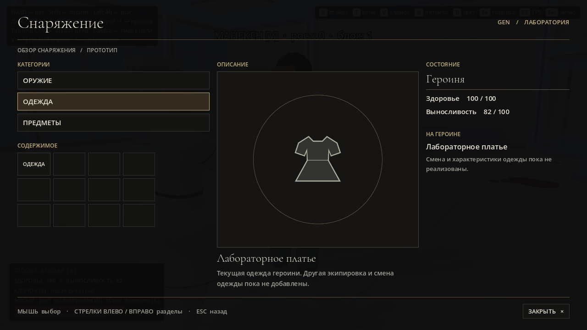
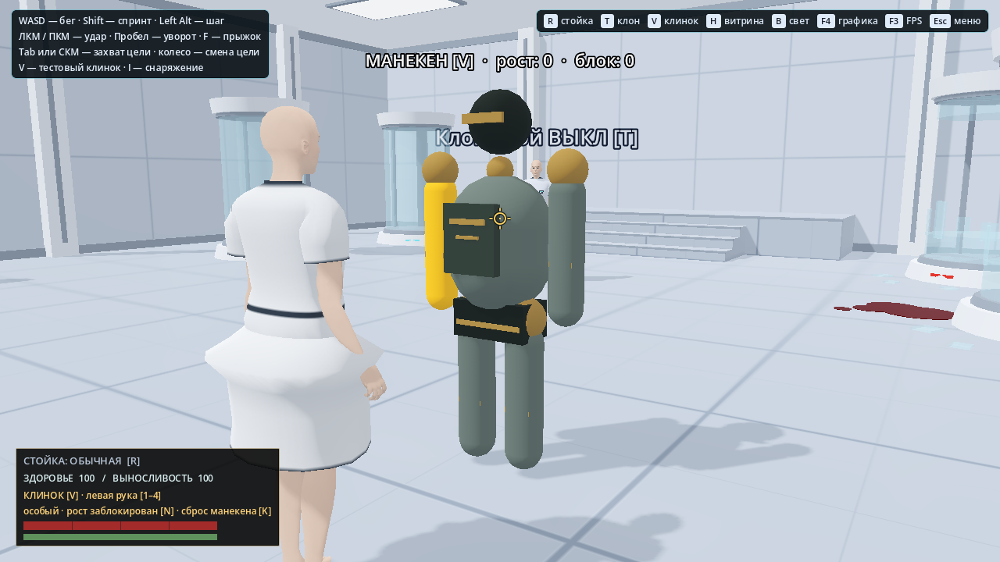

# 47 — интерфейс и манекен

[Видео демонстрации (MP4)](screens/souls-ui-047/demo.mp4) · [Одежда](screens/souls-ui-047/clothes-hd.png) · [Оружие](screens/souls-ui-047/weapons-hd.png) · [Предметы](screens/souls-ui-047/items-hd.png) · [Пауза](screens/souls-ui-047/pause-hd.png) · [Манекен](screens/souls-ui-047/manikin-hd.png) · [После удара](screens/souls-ui-047/manikin-cut.png)

## Что сделано

- **I** в игре или **Esc → Снаряжение** открывает обзор и ставит игру на паузу. Разделы выбираются мышью или стрелками влево/вправо; **Esc** возвращает к игре или в меню паузы, смотря откуда открыли экран.
- В одежде показано текущее лабораторное платье; иконка — условная пиктограмма, не изображение модели. Смена и игровые характеристики одежды ещё не реализованы. Строка одежды пока фиксирована под текущий прототип; при объединении с работой второго агента её нужно связать с фактическим выбранным костюмом.
- Оружия и предметов нет: ячейки пустые. Невидимый тестовый клинок не является предметом инвентаря.
- Пауза и индикаторы получили сдержанную тёмную палитру с тёплыми акцентами. Настройки и прежнее управление сохранены.
- Манекен получил более тёмную техническую оболочку, пояс, грудную панель и маркировку. Его столкновения, выбор четырёх конечностей, скрытые культи, физика и отрастание не изменялись. Это доработка простого учебного манекена, не законченная высокодетализированная модель.

## Референсы и ресурсы

Изучены композиции меню [Dark Souls 3](https://darksouls3.wiki.fextralife.com/Jp_inventory), [Dark Souls](https://gaming.stackexchange.com/questions/199082/how-do-i-use-the-sword-and-shield-i-found) и каталог [Elden Ring на Interface In Game](https://interfaceingame.com/games/elden-ring/): сетка слотов, тёмная подложка и золотистые акценты. Изображения, логотипы и графические ресурсы игр не использованы; интерфейс и пиктограмма нарисованы заново средствами Godot. Заголовки используют Cormorant Garamond из [Google Fonts](https://github.com/google/fonts/tree/main/ofl/cormorantgaramond), лицензия [SIL OFL](../prototype/assets/fonts/OFL-Cormorant.txt).

## Как получены кадры и видео

Снимки — реально отрисованная сцена Godot в браузерной среде WASM/SwiftShader, не макет. Для показа манекена использована временная обзорная камера и служебное расположение героини; в обычном проекте камера и управление не заменены. Скриншоты интерфейса — 1280×720. Видео — фактическая запись браузера 800×450, без звука, ускорена в **3 раза** и обрезана, чтобы убрать долгую загрузку и ожидание программного рендера; в ней меню паузы ещё до последнего уплотнения строк, окончательный вид — на скриншоте паузы. В браузерной записи на уменьшенном окне заметны артефакты/усечение некоторых рамок. Оценивать плавность, скорость боя или FPS по этой записи нельзя; целевая NVIDIA 940MX здесь не проверена.

## Проверки

Godot 4.7.2 headless: анимации 381, представление/пауза 47, макет конечности 13, комнатный манекен 29 проверок, без ошибок. В том числе проверены открытие по I, пустые категории и возвращение Esc в игру и в паузу. Тесты Python инструментов анимации: 40 OK. Графический просмотр был только в браузерном программном рендере, не на ноутбуке пользователя.
