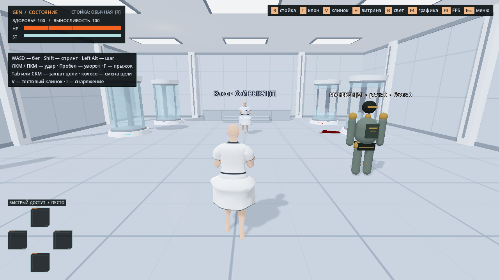
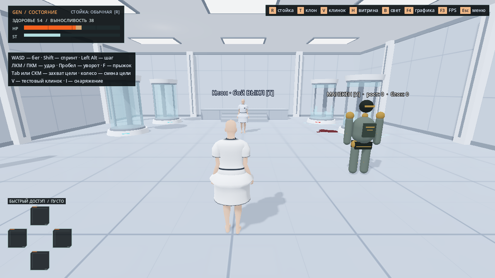

# 48 — игровой HUD в лабораторном стиле

[Видео (MP4)](screens/futuristic-hud-048/demo.mp4) · [Обычный вид](screens/futuristic-hud-048/normal.png) · [Неполные полосы](screens/futuristic-hud-048/damage.png) · [Режим манекена](screens/futuristic-hud-048/training.png) · [Небольшое окно](screens/futuristic-hud-048/small.png)

## Изменения

Предыдущий экран снаряжения был неверным пониманием запроса: здесь переработан именно **HUD во время игры**. Композиция вдохновлена [игровым экраном Dark Souls III](https://gaming.stackexchange.com/questions/317185/is-there-a-max-width-to-the-health-bar): статус вверху слева и четыре ячейки быстрого доступа крестом внизу слева. При этом оформление собственное, без игровых текстур или значков.

- Выбраны оранжевый для здоровья и акцентов, холодный почти белый для выносливости и графитовая подложка, читаемая на светлом фоне лаборатории. Посмотрены примеры [угловых sci-fi элементов](https://www.vecteezy.com/vector-art/76856940-minimal-futuristic-hud-interface-bars-and-sci-fi-ui-elements-set) и [оранжевого интерфейса](https://elements.envato.com/sci-fi-hud-game-ui-elements-kit-CMLPPPF), а также подход к читаемости и минимизации перегруженности в [обзоре принципов игрового UI](https://www.justinmind.com/ui-design/game). Сторонние графические ресурсы не включены в проект.
- Полосы связаны с настоящими здоровьем и выносливостью, сохранена «догоняющая» полоска потери здоровья. Отдельной третьей шкалы не добавлял: такой игровой ресурс ещё не реализован.
- Все четыре ячейки **пустые и пока декоративные**: оружия, предметов и управления быстрыми слотами ещё нет. Существующий невидимый клинок остаётся только тестовым инструментом манекена.
- Памятка перенесена ниже HUD, статус тренировки показывается отдельно. В узком окне верхняя плашка горячих клавиш скрывается, чтобы не перекрывать здоровье; при F3 в небольшом окне временно скрываются ячейки и подсказка тренировки, чтобы освободить место диагностике. При закрытии F3 они появляются снова.
- Отдельный экран снаряжения из предыдущей работы остался как был: это не полноценная система инвентаря и не отображение новых вариантов одежды второго агента.

## Проверка и ограничения

Кадры — работающая сцена Godot в браузерной среде WASM с программным SwiftShader. Кадры проверены при 1280×720 и 800×450, включая F3 и тренировочный режим. В видео 800×450 вырезана загрузка, звук отсутствует. Чтобы показать отклик полос, здоровье и выносливость установлены служебным тестом в 54 и 38, затем героиня служебно расположена у манекена; это не запись честного боя. Скорость записи не изменялась, но программный рендер медленный — оценивать по ней плавность или FPS на NVIDIA 940MX нельзя.

Godot 4.7.2: импорт и 381 проверка анимации, 55 представления, 13 макета конечности, 29 комнатного манекена — без ошибок. Проверены реальные значения полос, пустые слоты, отображение тестового клинка и отсутствие перекрытия начальной памятки с HUD. Движения, управление и механику боя эта работа не меняет. Новые анимации другого агента ещё не объединены.
